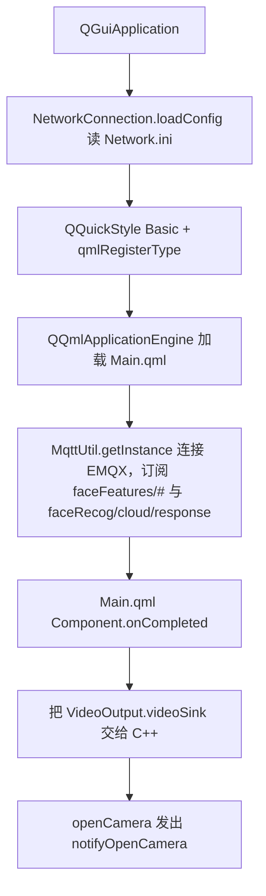
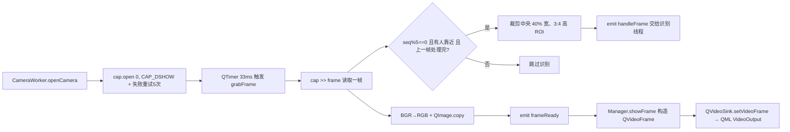
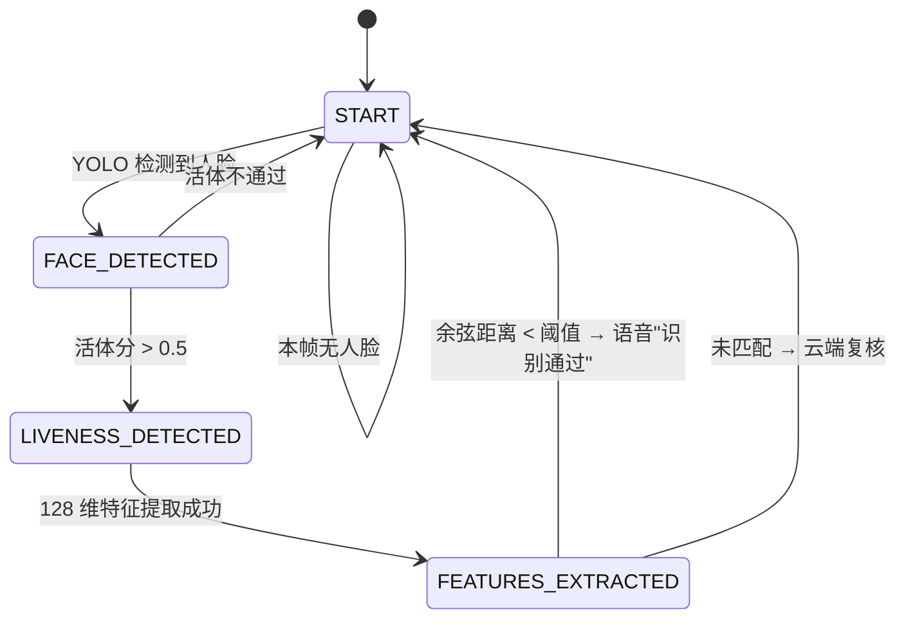
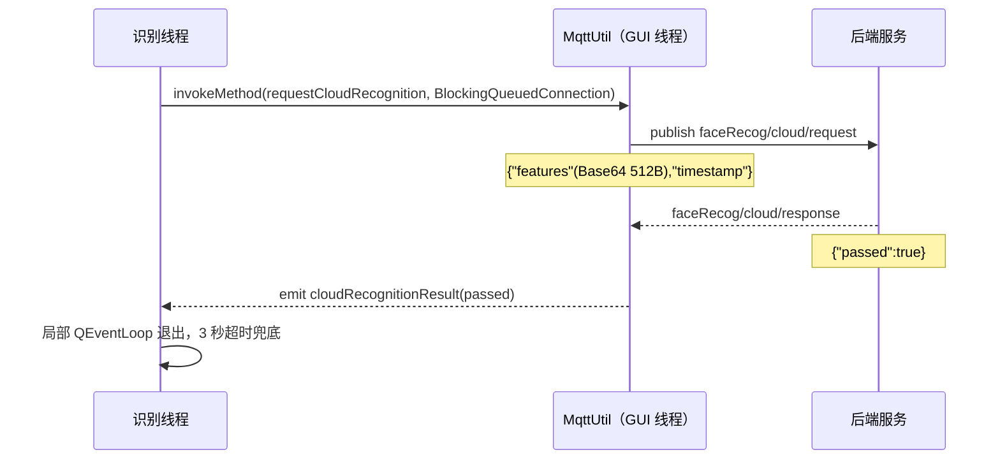
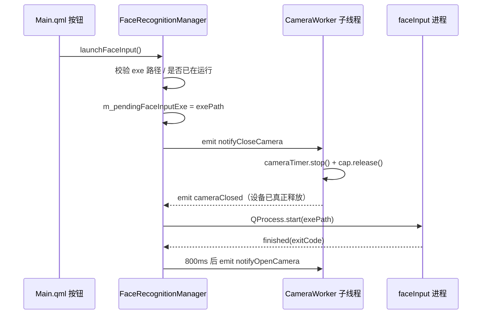
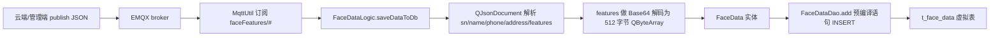
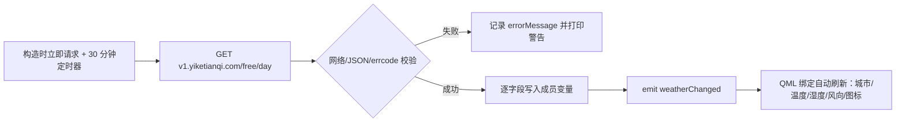

# 人脸识别门禁系统 —— 项目说明

一个基于 **Qt 6.8 + QML + OpenCV + dlib + SQLite-Vec + MQTT** 的人脸识别门禁终端程序。
摄像头常开预览，红外传感器（当前用定时器模拟）触发后，对画面中央引导框内的人脸依次做
**人脸检测 → 静默活体 → 特征提取 → 向量检索比对**，通过则语音播报放行。

---

## 一、目录结构

```
accessControlSystem_faceRecognition/
├── CMakeLists.txt                  # 构建脚本：依赖、模型路径宏、源文件清单
├── main.cpp                        # 程序入口：读网络配置、注册 QML 类型、启动 MQTT
├── Main.qml                        # 唯一的界面文件：摄像头画面 + 时间天气 + 录入按钮
│
├── resources/                      # 运行期资源（编译期宏指向这里，不在 qrc 里）
│   ├── model/                      # 全部 AI 模型
│   │   ├── yolo-face.onnx                        # YOLO 人脸检测
│   │   ├── MiniFASNetV2.onnx                     # 静默活体检测
│   │   ├── shape_predictor_68_face_landmarks.dat # dlib 68 关键点
│   │   └── dlib_face_recognition_resnet_model_v1.dat # dlib 128 维特征
│   └── weather/                    # 天气图标（qing/yun/yin/...）+ 背景图
│
├── sqlite3.c / sqlite3.h           # 原生 SQLite 源码，直接编进可执行文件
│
├── --- 界面门面层 ---
├── facerecognitionmanager.h/.cpp   # 门面类：管两条子线程 + 推帧给 QML + 启动录入程序
│
├── --- 采集层 ---
├── cameraworker.h/.cpp             # 摄像头子线程：抓帧、跳帧、引导框裁剪、预览推送
│
├── --- 识别层 ---
├── facerecognitionhandleworker.h/.cpp  # 识别子线程：四状态状态机，串起下面四个组件
├── facedetector.h/.cpp             # YOLO ONNX 推理 + 输出解码 + NMS
├── livenessdetector.h/.cpp         # MiniFASNetV2 静默活体
├── dlibutil.h/.cpp                 # 68 关键点 → 对齐 → ResNet 128 维特征
│
├── --- 数据层 ---
├── facedata.h/.cpp                 # 人脸记录实体（sn/name/phone/address/features）
├── facedatadao.h/.cpp              # 原生 SQLite C API + sqlite-vec KNN 查询
├── facedatalogic.h/.cpp            # 解析 MQTT 下发的 JSON 并入库
│
├── --- 通信层 ---
├── mqttutil.h/.cpp                 # MQTT 单例：连 broker、订阅 faceFeatures/#
├── networkconnection.h/.cpp        # 读取 Network.ini 的 WiFi / 组网参数
│
├── --- 辅助模块 ---
├── weatherservice.h/.cpp           # 易客天气 HTTP 请求 + JSON 解析，属性暴露给 QML
├── speechutils.h/.cpp              # QTextToSpeech 语音播报单例
└── modelpaths.h/.cpp               # 模型目录三级查找（环境变量 > 宏 > exe 同级）
```

构建产物在 `build/` 下，不参与源码说明。

---

## 二、分层与职责

| 层 | 类 | 职责 | 运行线程 |
|---|---|---|---|
| 界面 | `Main.qml` | 显示画面、引导框、时间天气、录入按钮 | GUI 线程 |
| 门面 | `FaceRecognitionManager` | 线程编排、帧格式转换、进程管理 | GUI 线程 |
| 采集 | `CameraWorker` | `cv::VideoCapture` 抓帧、跳帧、裁剪 ROI | 摄像头子线程 |
| 识别 | `FaceRecognitionHandleWorker` | 状态机调度检测/活体/特征/比对 | 识别子线程 |
| 算法 | `FaceDetector` / `LivenessDetector` / `DlibUtil` | 三次模型推理 | 识别子线程 |
| 数据 | `FaceData` / `FaceDataDao` / `FaceDataLogic` | 实体 / DAO / JSON 入库 | MQTT 回调线程 |
| 通信 | `MqttUtil` | 连接、订阅、分发消息 | GUI 线程（Qt 事件循环） |
| 辅助 | `WeatherService` / `SpeechUtils` / `NetworkConnection` / `ModelPaths` | 天气、TTS、配置、路径 | GUI 线程 |

设计上的核心思路：**QML 只认一个 C++ 对象（门面），所有耗时操作都在子线程，界面永不阻塞。**

---

## 三、用到的知识点

### 1. Qt / QML 集成

- **`qmlRegisterType` 注册 C++ 类型**：`main.cpp` 里把 `FaceRecognitionManager`、`WeatherService`
  注册到 `cn.rh` 模块，QML 中用 `import cn.rh` 后可直接声明对象。
- **`Q_INVOKABLE`**：`openCamera()`、`launchFaceInput()` 让 QML 按钮能直接调用 C++ 方法。
- **`Q_PROPERTY` + `NOTIFY`**：`displaySink` 可读可写带通知；`WeatherService` 用 14 个只读属性
  让 QML 直接绑定，一处 `weatherChanged()` 信号刷新全部绑定。
- **`QVideoSink` 推帧**：C++ 侧构造 `QVideoFrame`（`Format_RGBX8888` 单平面）并 `memcpy` 写入，
  再 `setVideoFrame()` 交给 QML 的 `VideoOutput` —— 这是把 OpenCV 画面送进 QML 的标准做法。
- **图片路径必须转 URL**：QML 的 `Image.source` 需要 `file:///`，所以 C++ 侧用
  `QUrl::fromLocalFile()` 转换。
- **`QQuickStyle::setStyle("Basic")`**：固定基础样式，避免不同平台控件外观差异。

### 2. 多线程（本项目重点）

- `FaceRecognitionManager` 构造时 `new QThread` + `moveToThread`，把 `CameraWorker`、
  `FaceRecognitionHandleWorker` 搬进各自线程，**跨线程信号自动走队列连接**。
- 线程间只用信号槽通信，没有任何共享锁；唯一共享的状态标志是
  `is_processing` / `isRecoginze`（布尔，写操作都在摄像头线程内）。
- `QAtomicInt m_frameCounter`：帧计数用原子操作，避免多线程自增的数据竞争。
- **子线程里的 OpenCV 调用必须 try/catch**：`open` / `>>` / `release` 在驱动异常时会抛
  `cv::Exception`，子线程中未捕获会直接 `std::terminate`，表现为"程序无日志闪退"。
- **定时器不能跨线程乱建**：`readSensor()` 里 `new QTimer(this)` 以对象为父，定时器会随
  `moveToThread` 一起迁移到子线程；若定时器留在 GUI 线程而回调里读写 `isRecoginze`，就会跨线程竞争。
- **`QTimer::singleShot` 做重试/延时**：摄像头打开失败后 300ms 重试（最多 5 次），
  因为 USB 设备句柄回收有延迟。

### 3. 计算机视觉

| 环节 | 模型 / 技术 | 关键参数 |
|---|---|---|
| 人脸检测 | YOLO ONNX，`cv::dnn::readNetFromONNX` | 输入 640×640，conf 0.25，NMS 0.45 |
| 检测后处理 | 输出 `[1,5,8400]` → `transpose` 成 `[8400,5]` → 解码 cx/cy/w/h | 按 `原图尺寸/640` 反缩放 |
| 候选框去重 | `cv::dnn::NMSBoxes` | 交并比阈值 0.45 |
| 活体检测 | MiniFASNetV2，输入 80×80 | 人框外扩 2.7 倍裁剪，3 类 softmax 取第 1 类真人概率 |
| 关键点 | dlib `shape_predictor` 68 点 | 用于对齐 |
| 人脸对齐 | `get_face_chip_details(shape,150,0.25)` | 输出 150×150 chip |
| 特征提取 | dlib ResNet → 128 维描述子 | 网络结构来自官方示例 |
| 特征检索 | sqlite-vec `vec0` 虚拟表 + KNN | `distance_metric=cosine`，`k=1` |

- **预处理**：`blobFromImage(..., 1/255, Size(640,640), mean=0, swapRB=true)`，`swapRB` 完成 BGR→RGB。
- **图像格式转换**：OpenCV 的 `cv::Mat` 是 BGR，QML 需要 RGB，所以 `cvtColor(BGR2RGB)` 后用
  `QImage(frame.data, w, h, frame.step, Format_RGB888)` 包装，**必须 `.copy()`**，否则 Mat 释放后是野指针。
- **坐标系**：`cv::Rect` 右下开区间，`dlib::rectangle` 闭区间，转换时要减 1（`toDlibRect`）。

### 4. 数据持久化

- **不用 Qt SQL 的原因**：Qt 自带 SQLite 编译时关闭了 `load_extension`，无法加载向量扩展，
  因此工程直接编译 `sqlite3.c` 源码，用 C API 操作。
- **sqlite-vec**：`CREATE VIRTUAL TABLE ... USING vec0(features float[128] distance_metric=cosine)`，
  查询 `WHERE features MATCH ? AND k = 1` 直接返回最近邻和距离，不用全表扫描。
- **预编译 + 参数绑定**：`sqlite3_prepare_v2` + `sqlite3_bind_blob/text`，防 SQL 注入，
  且 `vector<float>` 按原始字节（128×4=512 字节）以 BLOB 存入/查询。
- **资源位置**：`face.db` 与 `sqlite-vec.dll` 都放 exe 同级目录（`applicationDirPath()`）。

### 5. 网络通信

- **MQTT（Qt Mqtt 模块）**：`QMqttClient` 异步连接，`stateChanged == Connected` 后才订阅，
  订阅主题 `faceFeatures/#`（`#` 为多层通配符）。
- **HTTP（`QNetworkAccessManager`）**：异步 `get()`，`finished` 信号中解析，
  `reply->deleteLater()` 手动释放；`NoLessSafeRedirectPolicy` 允许跟随重定向。
- **JSON**：`QJsonDocument::fromJson` + `QJsonParseError` 校验，再按字段取值。
- **配置**：`QSettings(path, QSettings::IniFormat)` 解析标准 INI，比手写字符串切割可靠。

### 6. 进程管理

- `QProcess`（**不用 `startDetached`**）启动独立的人脸录入程序，才能收到 `finished` 通知并自动恢复摄像头。
- `setProcessChannelMode(QProcess::ForwardedChannels)` 把子进程输出转到主程序终端，便于排查闪退。
- 通过 `started` / `finished(exitCode, status)` / `errorOccurred` 三个信号判断启动成功、正常退出、
  异常退出（`-1073741515` 多为缺 DLL）。

### 7. 其他工程技巧

- **路径三级查找**（`ModelPaths` / `WeatherService` / `NetworkConnection` 统一套路）：
  环境变量 > 编译期宏（`target_compile_definitions`）> exe 同级目录。
- **MSVC 中文注释坑**：源码是 UTF-8，MSVC 默认按 GBK 解析会"吃掉"代码，所以
  `add_compile_options(/utf-8)`。
- **`project(... LANGUAGES C CXX)`**：只写 CXX 时 CMake 不报错但会静默跳过 `sqlite3.c`。
- **单例**：`MqttUtil`（禁用拷贝 + 局部静态变量）、`SpeechUtils`（函数内 static，C++11 线程安全）。
- **语音播报不阻塞界面**：`speek(text, ms)` 用 `QEventLoop` + `QTimer::singleShot` 实现
  "等待但不卡死 UI"。

---

## 四、功能流程

### 1. 启动流程



`main.cpp` 只做装配：读配置、注册类型、加载界面、拉起 MQTT，一步业务逻辑都没写。

### 2. 摄像头预览流程



要点：
- 预览是**每帧都推**（30fps），识别是**每 5 帧一次**且同一时刻只允许一帧在处理（`is_processing`）。
- 识别的输入是**中央裁剪出的 ROI**，与 QML 绿色引导框同比例（宽 40%、高=宽×4/3）；
  坐标属于裁剪图自己的坐标系，没有映射回原帧（所以界面上目前只有静态引导框，不画检测框）。

### 3. 识别状态机（核心）



进入 `FEATURES_EXTRACTED` 分支后的比对逻辑：

1. `FaceDataDao::findNearest(features)` 在 `vec0` 表中做 KNN，取距离最小的 1 条；
2. 距离小于阈值（当前代码写的是 `0.04f`）视为同一人 → 语音"识别通过，请通行" → 本轮结束；
3. 否则走云端复核：把 128 维特征 Base64 后经 MQTT 发给后端，最长等 3 秒，
   后端回 `passed=true` 才放行；未连接 / 超时 / 返回 false 一律判负（详见第 4 节）。

每帧处理结束都会 `emit frameHandleFinished(isFinished)`：
- 摄像头线程据此把 `is_processing` 置回 false；
- 若 `isFinished == true`，说明一次识别已经走完，把 `isRecoginze` 置 false，
  等待下一次"有人靠近"事件再重新开始。

### 4. 云端识别（MQTT 请求 / 响应）

本地向量库没命中时，不直接放行也不直接拒绝，而是把这一帧的特征交给后端再判一次。



- **线程安全**：`MqttUtil` 活在 GUI 线程，识别线程用 `Qt::BlockingQueuedConnection` 借它的线程发消息，
  只阻塞识别线程（`is_processing` 保持 true，不会堆积帧），界面和预览完全不受影响。
- **协议**：请求只有 `features`（Base64，512 字节）和 `timestamp`；响应只有 `passed`，
  不带请求 id、不带姓名，后端本次识别是放行还是拒绝直接由布尔值决定。
- **兜底策略**：MQTT 未连接、发布失败、3 秒无响应、`passed` 为 `false`，全部返回 `false`
  → 语音"识别失败，请录入人脸"，误识别不会开门。
- **后端约定**：`features` 做 Base64 解码后是 512 字节（128 个 float，小端序），
  比对后向 `faceRecog/cloud/response` 发布 `{"passed":true}` 或 `{"passed":false}` 即可。
- **手工联调**：用 MQTTX 订阅 `faceRecog/cloud/request` 看设备发出的特征，向
  `faceRecog/cloud/response` 发布 `{"passed":true}` 即可放行；**不要勾 Retain**，
  否则消息会被 broker 保留，设备重连时会立刻收到并直接放行。

### 5. 人脸录入流程（摄像头独占处理）

Windows 下 USB 摄像头是独占设备，主程序不放手，录入程序就打不开，所以流程是串行的：



- 用 **信号握手**（`cameraClosed`）代替固定 `sleep`，避免驱动回收句柄时长不确定；
- 另有 1.5s 兜底定时器：摄像头本来就没开时 `cameraClosed` 可能不来，强制启动；
- 子进程退出/启动失败后都要恢复主程序摄像头，否则界面永久黑屏。

### 6. MQTT 下发人脸 → 入库流程



约定：`features` 字段是 **128 个 float 的 Base64 字符串**，解码后正好 512 字节，
与 `vec0` 里 `float[128]` 的存储长度一致，维度不匹配会直接插入/查询失败。

### 7. 天气模块流程



- `m_loading` 做防重入，上一次请求没回来不会重复发；
- 图标按接口 `wea_img` 字段匹配 `resources/weather/<key>.png`，未知值兜底 `yin.png`；
- 背景图固定，用 `CONSTANT` 属性只取一次。

---

## 五、部署与已知问题

### 部署清单

1. 编译产物 `appaccessControlSystem_faceRecognition.exe`；
2. exe 同级放 `sqlite-vec.dll`（`face.db` 首次运行自动创建）；
3. 确保 `resources/model`、`resources/weather` 路径有效（或设 `FACE_MODEL_DIR` / `WEATHER_IMG_DIR`）；
4. `FACE_INPUT_EXE` 指向已编译的录入程序（或设同名环境变量）；
5. 本机 EMQX 的地址/账号在 `mqttutil.cpp` 顶部常量里改；
6. 统一用 **Release** 构建（OpenCV 本机库是 Release，Debug 会 LNK2019）。

### 需要留意的点

| 位置 | 现状 | 建议 |
|---|---|---|
| `facerecognitionhandleworker.cpp` 比对阈值 | `distance < 0.04f`，过于严格会频繁识别失败 | 按实测在 0.15~0.25 区间调 |
| 云端识别 | 本地未命中时经 MQTT 发特征，3 秒超时即判负 | 后端需实现 `faceRecog/cloud/request` → `faceRecog/cloud/response` |
| 检测框回显 | 检测在裁剪 ROI 上做，坐标未映射回原帧 | 换算后传给 QML，替换静态引导框 |
| `FaceDetector` 预处理 | 直接拉伸到 640×640，未保持宽高比 | 加 letterbox 可提升小脸精度 |
| 天气密钥 | appid/appsecret 硬编码在 `weatherservice.cpp` | 改成读环境变量，避免进仓库 |
| `CameraWorker` 构造 | 构造发生在 GUI 线程，`recogTimer` 在 `moveToThread` 之前创建并启动 | 依赖父子关系随对象迁移，若报 "Timers cannot be started from another thread"，把 `start()` 移到 `openCamera()` |
